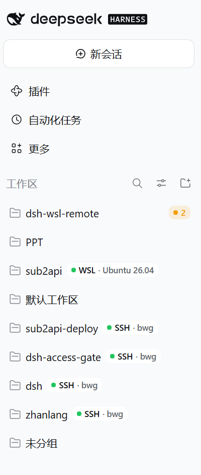
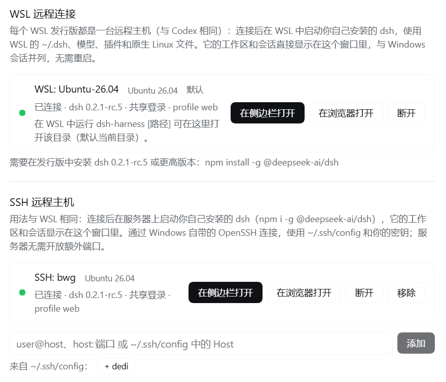
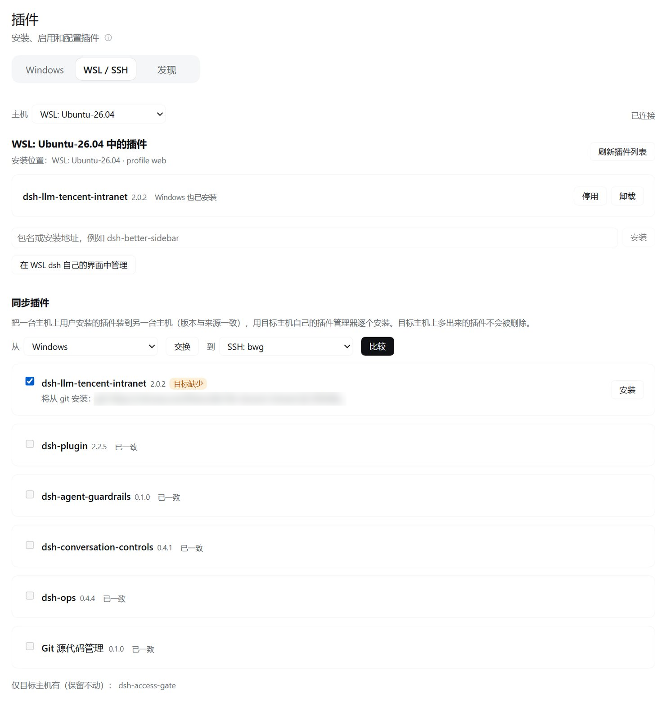
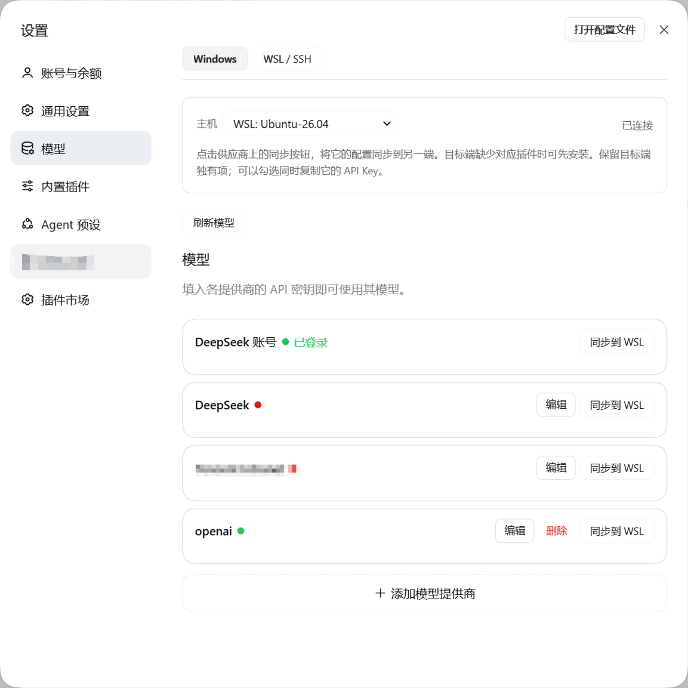

# @local/dsh-wsl-remote

[English](README.md) | 简体中文

让 DeepSeek Harness 像 Codex 桌面版一样支持 WSL 和 SSH 远程主机。**只需在 Windows 上安装一次。** 每个 WSL 发行版、每台 SSH 服务器都是一台远程主机，运行你自己用 `npm i -g @deepseek-ai/dsh` 装好的 `dsh`；它的工作区和会话直接合并到 Windows 的窗口里。

- **WSL 工作区**：添加工作区时选「WSL」，从 Linux 文件系统里挑一个文件夹。这个工作区的会话在 WSL 里你自己的 `dsh` 中运行：用 WSL 的 `~/.dsh` 配置、模型和插件，命令、文件读写和搜索都在 Linux 里执行，并使用你在 WSL 里配置的沙箱。会话列表、聊天视图、历史、实时输出、提问和授权确认都在 Windows 的同一个窗口里，和 Windows 会话并列。
- **SSH 远程主机**：用法与 WSL 完全一致。在 设置 → 通用 → **SSH 远程主机** 中添加 `user@host`、`host:端口` 或 `~/.ssh/config` 里的 Host，连接后服务器上你自己的 `dsh` 的工作区和会话同样合并到这个窗口；添加工作区时选「SSH」。见下文 [SSH 远程主机](#ssh-远程主机)。
- **插件管理与同步**：插件页按主机切换，查看和管理每台主机装了哪些插件，并把插件从一台主机同步到另一台。
- **模型配置与同步**：模型页按主机切换，编辑各主机的模型供应商，并把供应商配置（可连同 API Key）同步到另一台主机。
- **把会话复制到其他工作区**：会话菜单里的「复制到工作区…」把完整对话历史复制到任意工作区（本机或 WSL / SSH 远程主机），生成一个新会话在那里继续对话，原会话保持不变。
- **在远程 dsh 自己的界面里打开**：也可以通过本机回环中继，在侧边栏或浏览器里打开远程 dsh 的原生界面。
- **共享登录状态**（可选）：远程 dsh 直接使用 Windows 的凭据存储。
- **`dsh-harness` 命令**：在 WSL 终端里运行 `dsh-harness .`，把当前目录作为 WSL 工作区在 DeepSeek Harness 中打开，用法与 `code .` 相同。

| | Windows 工作区 | WSL / SSH 工作区 |
|---|---|---|
| 会话在哪个 dsh 里 | Windows 上的 DeepSeek Harness | WSL 或服务器上你自己的 `dsh` |
| 命令、文件、搜索在哪里执行 | Windows（PowerShell） | WSL / 服务器（Linux） |
| 模型、插件、Agent 配置 | Windows 的 `%USERPROFILE%\.dsh` | 远程主机的 `~/.dsh` |
| 显示在哪里 | 同一个窗口、同一个会话列表 | 同一个窗口、同一个会话列表 |

## 功能一览

### 本机与远程工作区在同一个列表里



本机工作区和远程工作区并列显示。远程工作区名字右侧有主机标记：WSL 工作区显示发行版的系统版本（例如 `WSL · Ubuntu 26.04`），SSH 工作区显示主机名（例如 `SSH · bwg`）；圆点颜色表示连接状态。点开会话后，聊天、历史、实时输出、提问和授权确认都在这个窗口里完成，工具调用在对应主机上执行。

### 连接 WSL 发行版和 SSH 主机



在 **设置 → 通用** 里管理远程主机。**WSL 远程连接** 自动列出本机的 WSL 2 发行版；**SSH 远程主机** 可以手动输入 `user@host`、`host:端口`，或一键添加 `~/.ssh/config` 里的主机。每台主机显示连接状态、远程 dsh 的版本、是否共享登录和启动的 profile，并可以在侧边栏或浏览器里打开远程 dsh 自己的界面、断开或移除。

### 插件：按主机管理，在主机之间同步



侧边栏 **插件** 页面的 **WSL / SSH** 标签里选一台主机，就能看到这台主机装了哪些插件，并标出与 Windows 的差别；可以直接安装、启用、停用、卸载。下方的 **同步插件** 可以选择从哪台主机到哪台主机（Windows、WSL、SSH 任意组合），点**比较**后，每个插件会标出在目标主机上缺少、版本不同还是已一致，再逐个或批量安装。详见下文 [插件：哪边装了什么](#插件哪边装了什么)。

### 模型：按主机配置，在主机之间同步



**设置 → 模型** 顶部可以切换 **Windows / WSL / SSH**。选中远程主机后，编辑的是那台主机自己的模型供应商。每个供应商都有同步按钮，可以把它的配置同步到另一端，并可选择同时复制 API Key；目标端缺少供应商插件时可以先安装。详见下文 [模型：切换主机与同步配置](#模型切换主机与同步配置)。

### 会话：复制到其他工作区

在侧边栏会话行的「…」菜单里选 **复制到工作区…**，弹出的列表按主机分组列出所有工作区（Windows、各 WSL 发行版、各 SSH 主机）。选一个工作区后点**下一步**，再确认要一并复制的文件，点**复制**：

- 新会话带着原会话到最后一轮完成为止的完整历史（消息、工具调用和结果、图片和文件附件），出现在目标工作区下并自动打开，可以直接接着对话。原会话不做任何改动。
- **一并复制会话生成的文件**：第二步列出这个会话新建或修改过的文件（来自它的写入、编辑工具调用和交付文件记录），复制的是它们现在的内容。
  - 原工作区里的文件按相对路径放到目标工作区，例如 `E:\proj\x\src\app.js` → `/home/me/x/src/app.js`。
  - 原工作区以外的文件放到目标工作区的 `.dsh-external` 文件夹，按原路径分层，例如 `E:\data\a.csv` → `.dsh-external/E/data/a.csv`，`/tmp/b.txt` → `.dsh-external/tmp/b.txt`。不会写到目标工作区以外的地方。
  - 默认勾选目标里还没有的文件；目标里已有的文件标为「目标已有」、默认不勾选，勾选后还要再确认「覆盖」才会替换，否则保留目标里的版本。同一个文件夹之间复制时不带工作区文件，同一台主机之间复制时不带工作区以外的文件（它们本来就在原位置）。
  - 选中超过 20 个文件时，在源主机打成一个 zip 传过去，到目标后自动解压到各自位置，结果和逐个复制一样。
  - 已删除的文件、超过 10 MB 的文件不会复制，会在列表下方说明原因（所选文件合计上限 30 MB）。模型收到的说明里会列出复制过来的文件，工作区以外的文件写明「原路径 → 新位置」。
- 新会话在目标工作区所在的主机上运行：复制到 WSL / SSH 工作区，就由那台主机上的 `dsh` 运行，用它的模型、插件和沙箱；复制回 Windows 同理。同一主机内的两个工作区之间也可以复制。
- 工作目录换成目标工作区的目录，**复制过去的历史里的路径也会跟着改**：原工作区文件夹的各种写法（Windows 路径、JSON 转义或正斜杠写法、WSL 会话里的 `/mnt/<盘符>/…`、Windows 看 WSL 文件夹用的 `\\wsl.localhost\<发行版>\…`）都换成目标文件夹，并用目标主机的写法；从工作区以外带过来的文件换成它在 `.dsh-external/` 下的新位置。改动范围包括消息、工具调用（参数仍是合法 JSON）和工具结果。以下内容保持原样：模型的推理内容和供应商的回放数据（改了会失效）、编辑差异里显示的文件内容、既不在工作区文件夹里也没有被复制的路径。模型在下一次请求前会收到一条说明：对话从哪里复制来、路径已经改过、现在的工作目录在哪里、哪些文件一起复制了过来。
- 和 DSH 自带的「分叉会话」一样，只复制已完成的轮次：正在进行的那一轮不会带过去，还没有完成任何一轮的会话不能复制。子智能体会话请从它的父会话复制。
- 定时任务和后台任务属于原会话，不会在副本里再次执行；原会话的目标会随历史带过去，但处于暂停状态（与重启后、分叉后一样），只有你手动恢复才会继续。

## 安装

### 1. 在 WSL 或 SSH 服务器上安装 dsh

在每台要连接的远程主机上安装你自己的 `dsh`：

- **WSL**：发行版必须是 WSL 2（在 Windows 上运行 `wsl -l -v` 查看），在 WSL 终端里安装。
- **SSH 服务器**：在服务器上安装。连接使用 Windows 自带的 OpenSSH，需要先配好密钥登录，并在 PowerShell 里手动 `ssh <主机>` 一次接受主机密钥，见下文 [SSH 远程主机](#ssh-远程主机)。

```bash
npm i -g @deepseek-ai/dsh
bash -lc 'dsh --version'   # 需要 0.2.1-rc.5 或更高；本插件支持 DeepSeek Harness 0.2.1-rc.5 到 0.2.2
```

缺少 dsh 或版本过低时，设置页会列出可以复制的安装命令，见下文。

### 2. 在 Windows 上安装插件

在 PowerShell 中运行以下命令。`dsh` 命令随 DeepSeek Harness 桌面版一起安装。

```powershell
git clone https://github.com/hasagiiii/dsh-wsl-remote.git
cd dsh-wsl-remote
dsh plugin --profile desktop add .
```

`add .` 会把该目录链接到桌面版配置（`%USERPROFILE%\.dsh\profiles\desktop`），并把 `@local/dsh-wsl-remote` 加入它的 bundle 列表。运行前请至少打开过一次 DeepSeek Harness 桌面版，确保该配置已经存在。

pnpm 可能会警告：链接进来的包不会从配置目录解析 peer 依赖（`@deepseek-ai/cordis` 等）。这个警告可以忽略，DeepSeek Harness 加载插件时会提供这些包。不要按提示改用 `file:`：那样安装的是一份副本，之后 `git pull` 的更新不会生效。

**不要在 WSL 或 SSH 服务器上的 dsh 中安装本插件。** 它只为 Windows 主机设计。

### 3. 启用

插件不替换 DeepSeek Harness 的任何内置组件，在插件管理里启用或停用后立即生效，不需要重启。

### 更新与卸载

```powershell
cd dsh-wsl-remote; git pull                                # 更新；插件是链接安装的，不需要再运行 add
dsh plugin --profile desktop remove @local/dsh-wsl-remote  # 卸载
```

WSL 中只会留下 `~/.dsh-wsl-remote` 和 `~/.local/bin/dsh-harness`，可以用 `rm -rf ~/.dsh-wsl-remote ~/.local/bin/dsh-harness` 清理。WSL 中的 `dsh` 及其 `~/.dsh` 属于你自己，不会被改动。

## 使用

### 连接发行版

打开 设置 → 通用 → **WSL 远程连接**，在 `WSL: <发行版>` 旁点**连接**。首次连接会把一个小型 agent 复制到 `~/.dsh-wsl-remote/agent/<版本>`，在登录 Shell 的 PATH 上检查 `dsh --version`（与 Codex 的版本检查相同），然后通过 `wsl.exe` 启动 `dsh --profile web`。已连接的发行版会在 DeepSeek Harness 启动时自动重连；打开一个尚未连接的发行版里的 WSL 会话时，也会自动连接。

### WSL 工作区

侧边栏的「添加工作区」和新会话页的「添加工作区…」会先询问类型：

- **本地**：打开 Windows 的文件夹对话框，与原来一样。
- **WSL**：选择发行版后打开一个基于 Linux 的文件夹选择器，从 Linux 主目录开始，可以输入路径（支持 `~`）、返回上一级、点面包屑跳转、显示隐藏文件夹、新建文件夹。

选好的文件夹会注册为 **WSL 里那个 dsh 的工作区**（它出现在 WSL dsh 自己的界面里，也出现在 Windows 窗口里）。它在任何地方（包括 Windows 窗口）都保持 Linux 路径（例如 `/home/me/repo`），名字右侧有 **WSL · <系统版本>** 标记（例如 `WSL · Ubuntu 26.04`），圆点颜色表示连接状态。WSL dsh 里原有的工作区和会话也会一并显示。

之前版本添加的 `\\wsl.localhost\…` 工作区会与 WSL 里同一文件夹的工作区合并成一行，并显示为 Linux 路径；之后新建的会话都在 WSL 的 dsh 里运行，以前在 Windows 上运行过的旧会话仍然留在原处。

已成功连接过的工作区和会话侧栏信息会缓存在 Windows 的 DSH home 下的 `wsl-remote-cache.json`。下次启动先显示上次的工作区、会话标题和顺序所需的标识，保留工作区展开状态，再在后台连接 WSL 并更新列表；连接失败时仍可看到上次列表。首次升级需要成功连接一次以建立缓存，之前已丢失的展开状态需要手动展开一次。缓存只保存侧栏元数据，不包含会话正文、输入队列或凭据；远程删除的项目在连接成功后从缓存移除。

### 插件：哪边装了什么

打开侧边栏的 **插件** 页面，顶部可切换 **Windows / WSL** 标签。Windows 标签保留本机插件列表和管理功能；WSL 标签选择发行版后，只显示该发行版安装的插件，并显示当前 profile。未连接的发行版会显示连接按钮，不会沿用另一台主机的列表。通用设置只负责 WSL 连接设置，不再放插件管理面板。

WSL 会话的 Agent（工具、技能、MCP 服务、模型提供方）用 WSL dsh 的插件。WSL 标签里还会标注与 Windows 安装的差别：

- **仅 WSL**：WSL 会话有，Windows 会话没有；
- **Windows 为 x.y.z**：两边都装了，但版本不同；
- **Windows 也已安装**：两边都装了，版本相同。

WSL 标签支持刷新、启用、停用、卸载，以及按包名或 WSL 安装地址安装插件。所有操作都带着选中的发行版名称，交给那个 WSL dsh 的插件管理器执行；Windows 标签仍操作 Windows profile。需要重启才能生效时，会提供“重启 WSL 中的 dsh”。还可以打开 WSL dsh 自己的完整界面。

安装在后台进行：面板实时显示当前阶段、已用时间和 pnpm 输出；**取消安装** 会通过 WSL 的插件管理器停止安装并还原配置。pnpm 超过一分钟没有输出时，面板会提示可能卡住并提供取消；窗口不会因为安装而一直等待。在一个窗口里开始的安装，换个窗口或刷新后仍能接着看到。

同一标签页列表下方的 **同步插件** 可以把插件从任意一台主机同步到另一台：Windows、WSL 发行版、SSH 主机，方向任选。选好**从**和**到**，点**比较**，然后点某个插件行上的**安装** / **更新** / **启用**按钮单独同步它，或勾选多个后点**同步所选**。同步进行中再同步同一对主机间的其他插件，会排到当前同步的末尾。每个插件会标出它在目标主机上的情况（缺少、版本不同、已停用、已一致），然后由目标主机自己的插件管理器逐个安装，实时显示输出，可以**停止同步**；已安装但停用的会被启用。从 npm 安装的插件会固定为来源主机的版本；git 来源保持原样；从 Windows 文件夹安装的插件在 WSL 中通过 `/mnt/<盘符>` 安装，SSH 主机访问不到这个文件夹。目标主机访问不到插件文件夹时，如果这个文件夹是某个 git 仓库的根目录、且当前提交已推送到远程分支，就改为从 git 安装，并固定到这个提交（本地有未推送的提交时，用最新一个已推送的提交）；面板会显示仓库和提交，并说明未推送的提交、未提交的修改不包含在内。其他情况面板会说明无法同步的原因。只有目标主机有的插件会列出来并保留，不会删除任何插件。开始同步时 Host 会重新比较一次，窗口只能选择插件名，不能指定安装地址。插件需要重启才能加载时，面板会提示。

### 模型：切换主机与同步配置

打开 **设置 → 模型**，顶部可切换 **Windows / WSL**。Windows 使用本机模型编辑器；WSL 选择发行版后，可以配置供应商、API Key、接口地址和模型列表，保存操作交给所选发行版。未连接时先点**连接**。

每个供应商都有自己的同步按钮：Windows 标签下点**同步到 WSL**，WSL 标签下点**同步到 Windows**。预览只包含该供应商的配置，点**确认同步**后写入；其他供应商不受影响。保留目标端独有的字段和模型，同名配置采用来源端的值。预览后目标配置有变化时会拒绝旧预览，需要重新预览。

对于插件提供的供应商，目标端缺少插件时可点**安装供应商插件**，已有但停用时可点**启用供应商插件**。安装使用来源端实际安装包的来源，支持两个方向，显示进度和日志，并可取消。完成后重新预览配置，仍需单独确认同步。安装包归属不明确、平台不兼容或本地来源路径无法转换时会说明原因。WSL 原生 Linux 目录中的本地插件需先发布或放到两端可访问的 Windows 目录。需要重启才能生效的插件会显示提示。

同步时也可以一并复制供应商的 API Key。预览会在**同时复制 API Key** 下列出目标端缺少、或值不同（会标明将被覆盖）的 Key，默认勾选；取消勾选则只同步配置。目标端已有且值相同的 Key 不会改动。Key 的值在 Windows Host 进程内从来源主机的凭据存储读出，再通过目标端的 `credentials/set` 写入：预览、结果、日志和窗口都拿不到这个值，出错时只显示 Key 的名称。远程主机上的值由其 dsh 内的 agent 读取，所以本版本之前建立的连接需要先重新连接。无法复制的 Key 仍会列为缺少，可在目标标签中补填。开启「共享登录状态」时，两端已经共用 Windows 的凭据存储，在任一端修改共享 Key 都会影响另一端。

更新本插件后，在插件管理中停用再启用 `@local/dsh-wsl-remote`，然后刷新窗口，即可加载新的模型页面，无需重启应用。

### 共享登录状态

开启「共享登录状态」（默认开启）后，WSL dsh 内的 agent 会通过 `wsl.exe` 管道，把每一次凭据读写都交给 Windows 的凭据存储处理：API Key、DeepSeek 账号登录和其他插件的凭据记录。WSL 中的每次 `modifyRecord` 都在 Windows 凭据存储的 `modifyRecord` 内部执行，处于它的跨进程写锁之下，所以两边的令牌刷新不会互相覆盖或作废。只有 WSL dsh 签发自己浏览器 Cookie 的密钥（`client-connection/browser-session`）留在 WSL。关闭共享后，WSL dsh 使用自己的 `~/.dsh/.credentials.yaml`。

设置项「WSL 中的 dsh 配置」决定连接时启动哪个 profile（默认 `web`）。这两项设置对新连接生效。

### 缺少 dsh 时的安装指引

连接时插件会在发行版的登录 Shell 中检测 `dsh`、`node`、`npm` 和 nvm。没有找到 `dsh` 或版本低于 0.2.1-rc.5 时，连接会停下，并在该发行版下方列出需要在 WSL 终端里依次运行的命令，每条都可一键复制。装好后点**重试**即可。

### `dsh-harness`

连接发行版时，插件会安装 `~/.local/bin/dsh-harness`（不需要 sudo；如果同名文件不是本插件创建的，则不会覆盖）：

```bash
dsh-harness            # 把当前目录作为 WSL 工作区在 DeepSeek Harness 中打开
dsh-harness ~/proj     # 打开指定目录
dsh-harness --focus    # 只把 DeepSeek Harness 窗口切到前台
```

它通过 WSL 互操作启动 Windows 上的 DeepSeek Harness（已在运行则切到前台），并把目录交给插件。目录通过 `<DSH 主目录>\wsl-remote\requests` 中的请求文件传递，WSL 一侧不打开任何端口。

### SSH 远程主机

SSH 主机的用法与 WSL 发行版一致，只是主机需要你手动添加：

1. 在服务器上安装 dsh（与 WSL 相同：`npm i -g @deepseek-ai/dsh`，版本须与 Windows 一致）。
2. 打开 设置 → 通用 → **SSH 远程主机**，输入 `user@host`、`host:端口` 或 `~/.ssh/config` 里的 `Host` 别名后点**添加**；`~/.ssh/config` 中的具体主机也会列成一键添加的按钮。
3. 点**连接**。之后与 WSL 完全相同：首次连接部署 agent 到服务器的 `~/.dsh-wsl-remote/agent/<版本>`，检查 `dsh --version`，启动 `dsh --profile web`；工作区和会话合并到这个窗口，侧边栏显示 **SSH · <主机>** 标记；插件页和模型页的远程标签里可以选 SSH 主机；可共享登录状态；自动重连；断开时清理服务器上的进程组。
4. 添加工作区时选「SSH」，选主机后在服务器的 Linux 文件系统里挑文件夹。

连接使用 Windows 自带的 OpenSSH（`C:\Windows\System32\OpenSSH\ssh.exe`），沿用 `~/.ssh/config`、密钥和 ssh-agent。所有数据都走这一条 SSH 会话的 stdio，服务器不需要开放额外端口，也不使用端口转发。连接以非交互方式进行（`BatchMode=yes`），**不能输入密码或确认主机密钥**：请先配置密钥登录，并在 PowerShell 里手动 `ssh <主机>` 一次接受主机密钥。认证、主机密钥或网络失败时，设置页会说明原因。

与 WSL 的区别：

- 没有 `dsh-harness` 命令（它依赖 WSL 互操作）。
- 「在应用中打开」不支持 SSH 上的文件：Windows 没有对应路径。
- Windows 本地文件夹（`link:F:/…`）安装的插件不能直接装到 SSH 主机（服务器看不到 Windows 磁盘），会改用包名从 npm 安装；模型页的「安装供应商插件」对这类插件会说明原因。

移除 SSH 主机后，服务器上只留下 `~/.dsh-wsl-remote`，可用 `rm -rf ~/.dsh-wsl-remote` 清理。

## 工作原理

```text
Windows 窗口（浏览器端，原样不改）
  │  /api（HTTP）、/api/remote.mux（WebSocket）
  ▼
Windows DeepSeek Harness Host
  Gateway ── 本插件的合并层（lib/bridge）
  │   ├─ Windows 会话、Windows 工作区 → 原样交给 Windows 的服务
  │   └─ WSL 会话、WSL 工作区 → DeepSeek Harness 官方客户端包
  │        （dsh-client-connection、dsh-api-gateway/client、dsh-typert-registry）
  │          └─ Windows 本机回环中继 ⇄ wsl.exe 标准输入输出 ⇄ WSL 里你的 dsh
  └─ 会话列表、搜索、工作区、会话控制流、事件流：多台主机合并
  Web 服务器 ── WSL 会话的插件路由（如 /sidebar/*）→ WSL dsh 里的同一个插件
```

### 调用属于哪台主机

Codex 的窗口在每个请求里都带 `hostId`。DeepSeek Harness 的客户端没有这个字段：它只连一个 Host，用 ID 指代会话、Agent 和工作区。所以合并层按下面的顺序，从这些 ID 推断每个调用的归属：

1. **调用指明了工作区**（`session/create`，以及带 `workspaceId`、不带 `sessionId` 的其他 `workspace/*` 调用，如重命名、删除）。合并层用各主机的 `workspace/follow` 流拼出一张工作区表，每一行都记着来自哪台主机（`owners`：合并后的 ID → `{ 主机, 该主机上的 ID }`）。调用发给那台主机，ID 换成它自己的。
2. **调用要新建工作区**（`workspace/create`）。WSL 文件夹选择器传来的 `\\wsl.localhost\<发行版>\<路径>` 只当作地址：从中读出发行版，再用 Linux 路径在那个发行版的 dsh 里创建。其他路径都是 Windows 文件夹。
3. **调用指明了会话、Agent 或子会话**。从调用参数里读取 ID：`agentId`、`workspaceFileScopeId`、`sessionId`、`parentSessionId`、`childSessionId`、`rootSessionId`，`request` 里的同名字段，以及 `request.address`。第一个能查到归属的 ID 决定主机。归属来自：
   - 各主机的会话列表（`session/list` 会合并所有主机的列表，每一行都记下来源）；
   - 各主机工作区行里的 `sessionIds`；
   - 各发行版的 `session/control` 投影和 `$events` 事件（`api-session/added`、状态、活动）；
   - `session/create` 和 `session/fork` 的返回结果，在返回的当下就记下。
4. **ID 还不认识**（在别处新建、尚未出现在列表里的会话）：先问 Windows（它的活动会话，再查它保存的会话记录），再依次用 `session/projections` 问每个已连接的发行版。第一个认识这个 ID 的主机就是归属，结果会记下来。
5. **调用不指向任何主机**（`session/list`、`session/search`、窗口的模型目录、设置、插件管理、账号）：发给 Windows；其中的集合类调用会再与各发行版的结果合并。

插件的 HTTP 路由和 WebSocket 用同样的规则，从请求里找 ID：`?sessionId=` 等查询参数、本身就是会话 ID 的路径段（`/sidebar/html/<会话 ID>/…`），或 JSON 请求体里的 ID 字段。单独的 Linux 路径（Markdown 文件链接、`/api/file?path=`）交给包含它的 WSL 工作区所在的发行版（取最深的那个），否则交给唯一已连接的发行版。

结果都会缓存，每个 ID 只解析一次。发行版返回的工作区和会话会立即记入合并层，不等它的 follow 流再推一遍：窗口添加 WSL 工作区后会紧接着在里面新建会话。

- **调用路由**：见上一节。调用原样交给它的主机，只替换合并后的工作区 ID 和选择器传来的 `\\wsl.localhost` 地址。
- **路径**：WSL 的工作区、会话目录和历史快照头在 Windows 窗口里保持 Linux 路径；属于哪个发行版由工作区或会话决定，不靠路径判断。只有「在应用中打开」会把 Linux 路径转成 `\\wsl.localhost\<发行版>\…`，因为那是由 Windows 打开文件。
- **合并的流**：`workspace/follow` 每次变化都下发完整的合并状态（`replace` 帧）；`session/control` 在开场基线里带上各发行版的投影，之后转发各主机的增量；`$events` 转发 WSL 会话的事件（会话状态、活动、提问、授权确认等），并把 Windows 窗口对提问和确认的回答送回对应的 WSL dsh。
- **文件、终端、git**：DSH 自带的文件预览（`workspaceFiles/*`）、终端（`terminal/*`）、后台任务、目标和文件上传都带着会话 ID，所以和 Codex 的 `fs/*`、`command/exec` 一样在 WSL 里执行。插件路由也是如此：两边都装了的插件（例如 dsh-better-sidebar 的文件树、编辑器、git 视图和终端，路径为 `/sidebar/*`），WSL 会话的请求由 WSL 里的同一个插件处理。精确路由（会话日志导出、原始上传、`/api/file`、变更对比）按 `sessionId` 或路径转发。
- **模型**：窗口的模型目录是 Windows 的。WSL 会话的模型选择器使用该发行版自己的模型目录，所以只列出、默认选中并校验 WSL dsh 能路由的模型；Windows 会话只列出 Windows 的模型。
- **退出清理**：WSL 里的 dsh 以独立进程组组长的身份启动，并上报 PID 和启动时间。连接结束时整组一起结束（先 TERM 再 KILL），之前先核对启动时间，绝不会误杀复用了该 PID 的进程，所以工具、MCP 服务和终端不会残留。
- **认证**：使用 WSL dsh 文档化的 API 接入方式：`GET /connect?token=<启动令牌>&interactions=answer` 换取签名的 API Cookie，之后 HTTP 和 mux WebSocket 都带这个 Cookie。WSL 一侧不打开任何非回环端口。

### 源码

- `index.js`：Host 插件，负责发现、连接、设置路由、文件夹选择器，以及安装合并层。
- `lib/bridge/bridge.js`：合并层，包括归属判断、路由、合并流和对 Gateway / Fetch 路由的包装。
- `lib/bridge/routes.js`：WSL 会话的插件 HTTP 路由和 WebSocket，交给 WSL dsh 处理。
- `lib/bridge/merge.js`：纯函数部分，包括从调用和请求中提取 ID、工作区合并、判断 Linux 路径属于哪个发行版。
- `lib/bridge/host-client.js`：用 DeepSeek Harness 官方客户端包组装的 WSL dsh 客户端。
- `lib/remote.js`：一个远程连接（WSL 或 SSH），负责部署、版本检查、启动、本机回环中继、应答凭据请求，以及带退避的自动重连。
- `lib/transport.js`：在远程主机上运行 Linux 命令：WSL 用 `wsl.exe -d`，SSH 用 `ssh -T -o BatchMode=yes`（参数逐个加单引号）；以及 `~/.ssh/config` 解析。
- `server/launch.sh`、`server/agent.mjs`：通过登录 Shell 启动 `dsh`；agent 是通过 `dsh --patch` 加载的 Cordis 插件，只在被 Windows Host 启动时运行。管道上在 mux 帧之前先输出一行标记，SSH 登录 Shell 的欢迎信息会被丢弃。
- `server/dsh-harness.sh`、`lib/requests.js`：`dsh-harness` 命令。
- `server/session-copy.mjs`、`server/workspace-files.mjs`、`server/path-rewrite.mjs`、`lib/session-copy.js`：会话复制。读取和创建两半都只用 dsh 自己的服务（`sessionQuery`、附件存储、`agents.create` 带种子历史，与「分叉会话」相同的方式），工作区文件用 `node:fs` 读写，`path-rewrite.mjs` 把历史里的路径改到目标位置；同一份文件既在 Windows Host 里运行，也随 agent 部署到远程主机、经管道调用。
- `lib/linux-fs.js`：WSL / SSH 文件夹选择器，以及选择器地址（`\\wsl.localhost\…`、`ssh://<主机>/…`）与主机和 Linux 路径之间的转换。

## 限制

- WSL 的 dsh 必须与 Windows 上的 DeepSeek Harness 是同一版本：合并的会话使用 Windows 端的 Remote API。
- 合并层包装的是 DeepSeek Harness 内部的 Gateway 分发入口（`dispatchRpc`、`openWireStream`）、Connection 的精确路由表、Web 服务器的路由表和模型选择器的会话目录，DSH 升级后可能需要同步更新（`engines.dsh`）。归属是从 ID 推断的（见上文），不像 Codex 那样由窗口通过 `hostId` 声明。
- 发行版断开时，它的会话仍显示在列表里（最后一次的状态），打开时会自动重连。正在进行的流会中断，DSH 客户端会照常重连。
- 只合并与会话相关的事件。WSL dsh 的设置和账号页面不会出现在 Windows 窗口里；它的插件可以在上面的 WSL 插件面板里管理，或者在它自己的界面里管理。
- 只出现过一次、之后无法复现：WSL 插件管理器启动的 pnpm 已写好依赖（日志以 `Done` 结束），但进程没有退出。之后通过同一路径反复安装，都在几秒内完成。如果再次出现，面板会在一分钟后提示可能卡住，**取消安装** 会还原配置。
- 卸载从 Windows 文件夹链接安装的插件后，WSL profile 的 `node_modules` 里可能残留它的链接（pnpm 已不再记录，所以不会被加载）；无害，下次安装时会被替换。
- 插件的侧边栏要在 WSL 会话里可用，WSL 的 dsh 里也必须装同一个插件，否则它的 WSL 请求会失败。不指向任何会话的插件路由（共享资源、全局设置）始终由 Windows 处理。
- 「在应用中打开」通过 `\\wsl.localhost`（9P）在 Windows 上打开 WSL 文件。
- 工作区行没有供插件使用的扩展位，WSL 标记是插入到侧边栏页面中的；DSH 调整侧边栏结构后可能需要更新插件。
- 复制会话时，整段历史、附件和所选文件在一条管道消息里传输，上限 60 MB；更大的会话会提示无法复制。跨主机复制时，副本的模型选择使用目标主机的默认模型。
- 一并复制的文件是从会话自己的工具调用里找出来的。通过命令（例如 `bash` / `pwsh`、构建、`git`）改动的文件不会列出，这类文件请用 git 同步或手动复制。

## 开发

测试使用 DeepSeek Harness 的 Electron 可执行文件作为 Node 运行，以便解析已安装的 DSH 包（`DSH_ROOT` 可覆盖默认路径 `D:/ds_harness/resources/app.asar/dsh`）。

```powershell
$env:ELECTRON_RUN_AS_NODE = '1'
$dsh = 'D:\ds_harness\DeepSeek Harness.exe'
& $dsh --import ./test/resolve-dsh.mjs test/unit.mjs           # 合并、路径、安装指引、协议、迁移、共享凭据加锁
& $dsh --import ./test/stub-cordis.mjs test/smoke-host.mjs     # Host 插件路由与 WSL 文件夹列表
$env:WSL_DISTRO = 'Ubuntu-26.04'
& $dsh --import ./test/stub-cordis.mjs test/remote.mjs         # 真实 WSL：远程连接的部署、启动、中继
```

启动演练：在临时 DSH 主目录中按桌面版的方式启动真实的组合，连接发行版，经 Windows Gateway 创建 Windows 会话和 WSL 会话、向 WSL 会话发送提示并读取历史、实时输出和事件，不影响正在运行的应用：

```powershell
# 在 .scratch/boot-home 建临时 DSH 主目录：复制桌面版 profile 的清单，node_modules 用目录链接指向原处
$h = & $dsh test/boot-home.mjs
$env:DSH_HOME = $h; $env:DSH_TELEMETRY_DISABLED = '1'; $env:DSH_CLIENT_VERSION = '0.2.1-rc.5'
& $dsh --expose-internals --import ./test/resolve-boot.mjs test/boot-desktop.mjs "$h\profiles\desktop" (Get-Location).Path Ubuntu-26.04
# WSL 会话的插件路由、发行版自己的模型目录、断开时的进程组清理
& $dsh --expose-internals --import ./test/resolve-boot.mjs test/boot-wsl-session.mjs "$h\profiles\desktop" Ubuntu-26.04
# 列出发行版的插件并与 Windows 对比；通过面板的接口停用再启用一个
& $dsh --expose-internals --import ./test/resolve-boot.mjs test/boot-wsl-plugins.mjs "$h\profiles\desktop" Ubuntu-26.04 dsh-vscode-mode
# 保持组合运行并开放网页界面，便于在浏览器里操作真实客户端
& $dsh --expose-internals --import ./test/resolve-boot.mjs test/serve-desktop.mjs "$h\profiles\desktop" Ubuntu-26.04
# 再对开启了 --remote-debugging-port=9333 的无头 Chrome 执行操作步骤
& $dsh test/cdp.mjs 9333 <steps.mjs>
```

`server/agent.mjs`、`server/launch.sh`、`server/dsh-harness.sh` 或 `lib/mux.js` 变化时，请递增 `lib/remote.js` 中的 `AGENT_VERSION`。

SSH 路径的测试不需要真实服务器：`test/fake-ssh.mjs` 接收 ssh 的真实参数，先在 stdout 打印登录欢迎信息，再把命令字符串交给一个 WSL 发行版的 Shell 执行：

```powershell
& $dsh --test --test-isolation=none test/ssh.mjs test/client-ssh.mjs     # 参数拼接、地址、~/.ssh/config、欢迎信息跳过、设置、路由、界面
$env:DSH_FAKE_SSH_DISTRO = 'Ubuntu-26.04'
& $dsh --import ./test/stub-cordis.mjs test/ssh-remote.mjs              # 经 SSH 代码路径部署、启动、中继、列目录、断开后清理进程组
```

## Community & Links

[LINUX DO](https://linux.do)
